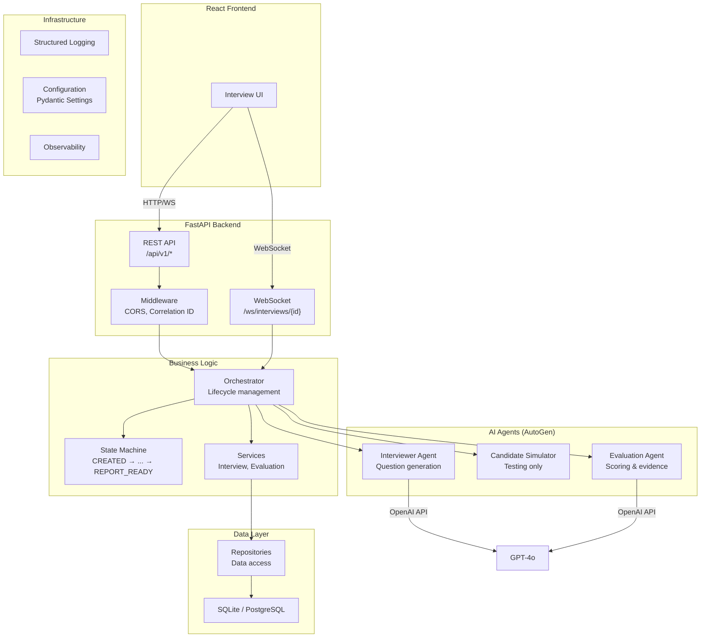
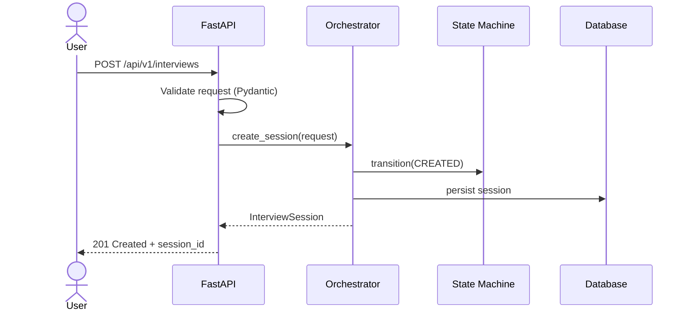

# ARIES Architecture

## System Overview

ARIES is a multi-agent AI system that automates candidate interviews. It uses Microsoft AutoGen for agent orchestration, FastAPI for the web API, and React for the frontend.

## Component Diagram

## Key Design Decisions

### 1. Explicit State Machine (not LLM-driven state)

The interview lifecycle is an explicit Python state machine with defined transitions. The LLM generates questions and evaluations, but it does NOT decide what state the interview is in. This makes the system predictable and debuggable.

### 2. Adapter Pattern for Agents

AutoGen agents are wrapped in thin adapter classes. If AutoGen's API changes, we update the adapter, not every call site. This also makes agents independently testable.

### 3. REST-First, WebSocket-Second

All state is persisted and retrievable via REST. WebSocket is a live notification overlay. If the WebSocket disconnects, no data is lost — the client can poll REST to catch up.

### 4. Deterministic Score Aggregation

The LLM evaluates each competency qualitatively and assigns per-competency scores. The final aggregate score is computed by a deterministic Python function (weighted average), not by the LLM. This makes scoring auditable and reproducible.

### 5. Separation of Request/Response/Internal Models

- **Request models**: What the API caller sends (no server-generated fields)
- **Internal models**: Full state representation (includes session_id, timestamps)
- **Response models**: What the API returns (may omit internal details)

## Data Flow: Creating an Interview

## Technology Stack

| Layer | Technology | Version |
|-------|-----------|---------|
| Language | Python | 3.13 |
| Web Framework | FastAPI | 0.115.x |
| Agent Framework | AutoGen (agentchat + ext) | 0.7.5 |
| LLM | OpenAI GPT-4o | Latest |
| Database | SQLAlchemy + aiosqlite | 2.0.x |
| Validation | Pydantic | 2.x |
| Frontend | React + Vite + Tailwind | Latest |
| Testing | pytest + pytest-asyncio | 8.x |

## Directory Responsibilities

| Directory | Responsibility |
|-----------|---------------|
| `app/core/` | Configuration, settings |
| `app/api/routes/` | HTTP endpoint handlers |
| `app/schemas/` | Pydantic models (data shapes) |
| `app/database/` | SQLAlchemy engine, models, migrations |
| `app/agents/` | AutoGen agent wrappers |
| `app/orchestration/` | Interview lifecycle, state machine |
| `app/services/` | Business logic |
| `app/repositories/` | Database access (CRUD) |
| `app/observability/` | Logging, tracing |
| `app/prompts/` | LLM prompt templates |
| `app/memory/` | Session memory, Mem0 integration |
| `tests/` | All test files |
